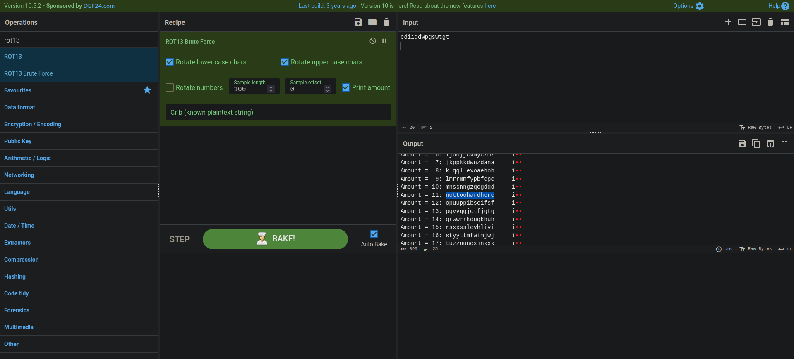

# Snow Crash - Level 00

## 🎯 Objective

Escalate privileges from user `level00` to `flag00` to retrieve the first authentication token.

## 🔍 Discovery

1. **Restricted Environment:** The home directory for `level00` had no visible files and restricted permissions for `ls`.
2. **System Search:** A recursive search for files owned by the target user `flag00` was performed:
```bash
find / -user flag00 2>/dev/null

```


3. **Interesting Files:** The search revealed two identical files:
* `/usr/sbin/john`
* `/rofs/usr/sbin/john`


4. **Obfuscated Content:** Running `cat /usr/sbin/john` revealed the ciphertext:
> `cdiiddwpgswtgt`


## 🛠️ Decoding (CyberChef Method)


The string appeared to be a simple substitution cipher. To solve it:

* **Tool:** [CyberChef](https://gchq.github.io/CyberChef/)
* **Recipe:** `ROT13 Brute Force`
* **Input:** `cdiiddwpgswtgt`
* **Finding:** At an amount (shift) of **11**, the output transformed into human-readable text: **`nottoohardhere`**.

## 🚩 Capture

1. **Switch User:** Use the decoded password to become the flag user.
```bash
su flag00
# Enter password: nottoohardhere

```


2. **Get Flag:** Run the internal utility to get the token for the next level.
```bash
flag00@SnowCrash:~$ getflag
Check flag.Here is your token : x24ti5gi3x0ol2eh4esiuxias

```


